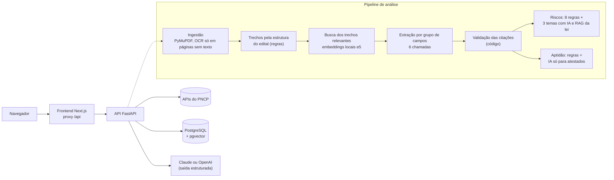

# Edital Claro

Lê editais de licitação de obras públicas com IA e mostra o que importa para quem vai
participar: dados principais, checklist de habilitação, riscos à luz da Lei 14.133/2021 e
se uma empresa está apta. **Cada informação cita a página e o trecho literal do edital**, e
um clique abre o PDF com o trecho destacado.

[](https://github.com/BiancaVolpato/edital-claro/actions/workflows/ci.yml)

- **Demonstração pública:** três editais já analisados, sem espera e sem custo
  (endereço publicado após o deploy; ver [docs/DEPLOY.md](docs/DEPLOY.md)).
- **Vídeo de 3 minutos:** roteiro em [docs/ROTEIRO_VIDEO.md](docs/ROTEIRO_VIDEO.md).

## O problema

Editais de obra são PDFs longos (de 28 a 88 páginas nos cinco exemplos deste repositório),
em linguagem jurídica, e cada órgão escreve de um jeito. As exigências que eliminam uma empresa estão espalhadas pelo texto.

**Um exemplo real.** O edital da Concorrência Eletrônica nº 4/2026 de Witmarsum (SC), que
está em [data/samples](data/samples/README.md), tem 33 páginas. Para participar, a empresa
precisa, entre outras coisas:

- de atestados que somem **3.404 m²** de pavimentação, na seção de qualificação técnica;
- de **patrimônio líquido de 10% do valor estimado** (R$ 3.809.907,22), ou seja,
  R$ 380.990,72, conta que o edital deixa para a empresa;
- de **certidões válidas na data da sessão**, que é 15/10/2026.

Uma construtora pequena com dois atestados de 2.100 m² e 1.500 m² e patrimônio de
R$ 450 mil passa nos dois primeiros itens. Mas uma certidão estadual que vence em 10/10,
cinco dias antes da sessão, a desclassifica. O Edital Claro aponta exatamente isso, com a
página de cada exigência. É o teste de aceitação da etapa de aptidão
(`backend/tests/test_eligibility_api.py`); a empresa é fictícia, o edital e os trechos são
reais.

Quem sofre com isso:

- **pequenas construtoras**, que perdem prazos e são desclassificadas por um documento;
- **prefeituras pequenas**, que publicam cláusulas restritivas e recebem impugnações.

## Por que IA, e não só regras

Regras sozinhas não dão conta, e IA sozinha não é confiável. O sistema usa cada uma onde ela
é melhor:

| Tarefa | Quem faz | Por quê |
| --- | --- | --- |
| Achar o valor estimado, as datas, as exigências | IA | Cada edital escreve diferente: "Valor previamente estimado em R$ 60.296,85" (Lauro Müller), "VALOR ESTIMADO GLOBAL DE CONTRATAÇÃO: R$ 3.809.907,22" (Witmarsum), "valor máximo admitido para a contratação é de R$ 22.549.875,04" (Florianópolis); regex quebraria a cada órgão |
| Dizer se um atestado de "recapeamento em CBUQ" serve para "pavimentação asfáltica" | IA | É julgamento de equivalência técnica, não comparação de texto |
| Apontar exigência que pode restringir a competição sem um número na lei (atestado de serviço específico demais, vedação sem justificativa) | IA, em 3 temas, com o artigo recuperado do texto oficial | Exige interpretação |
| Conferir se o trecho citado existe na página | código | A defesa contra alucinação não pode depender do modelo |
| Somar quantitativos, calcular percentuais, comparar datas | código | Contas são onde LLMs erram; a IA nem recebe as quantidades dos atestados |
| Prazo mínimo entre publicação e abertura, teto de garantia, patrimônio acima de 10%, visita técnica obrigatória | código (8 regras) | A lei define em números; regra é exata e auditável |

Tudo o que a IA responde passa por validação: valor sem trecho confirmado no documento vai
para revisão, risco sem citação e sem artigo da lei é descartado, código de requisito
inventado é ignorado.

## Telas

<!-- As capturas são geradas da demonstração, depois dos snapshots reais (just demo-generate):
     just screenshots
     Depois de gerar, troque este comentário pelas imagens:


-->

As capturas de tela saem da demonstração, com análises reais, por `just screenshots`
(Playwright, usando o Chrome instalado). Elas entram aqui junto com os snapshots da demo,
que dependem da chave da API ([data/demo](data/demo/README.md)).

O fluxo na interface:

1. **Início:** envie um PDF ou busque no PNCP e importe o edital.
2. **Análise:** à esquerda, as abas Campos (com confiança e selo "Revisar"), Checklist e
   Riscos; à direita, o PDF. Clicar em "p. 5" abre a página com o trecho destacado.
3. **Aptidão:** escolha o perfil da empresa e veja exigência por exigência o que atende, o
   que não atende e o que verificar, com o que falta e os prazos críticos.
4. **Exportar:** relatório em Markdown ou PDF pela impressão do navegador.

## Arquitetura



- **Backend:** Python 3.12, FastAPI, Pydantic v2, SQLAlchemy, Alembic, uv.
- **IA:** Claude (Anthropic) ou modelos da OpenAI, escolhidos por `LLM_PROVIDER`, atrás de
  uma interface `LLMProvider`; embeddings
  locais (`multilingual-e5-base`); prompts versionados em arquivos com hash.
- **Banco:** PostgreSQL com pgvector (a Lei 14.133 indexada por dispositivo, com busca
  híbrida vetorial e textual).
- **Frontend:** Next.js 16, TypeScript, Tailwind, shadcn/ui, react-pdf.
- **Qualidade:** pytest, ruff, mypy, ESLint, GitHub Actions (testes em PostgreSQL real e
  build das imagens Docker).

## Resultados da avaliação

| O que foi medido | Resultado | Onde |
| --- | --- | --- |
| Busca na Lei 14.133 (10 perguntas, recall@5) | **0,90** na busca híbrida (meta: 0,80); 0,90 só vetorial; 0,60 só texto | [eval/law_search/RESULTADOS.md](eval/law_search/RESULTADOS.md) |
| Testes automatizados | 438 passando em PostgreSQL, incluindo testes de aceitação com trechos reais dos editais de exemplo | `just test` |
| Cobertura de testes do backend | **96%** das linhas de `app/` | `just coverage` |
| Extração de campos (precisão, recall, alucinação por campo, custo e latência por modelo) | **pendente**: o avaliador está pronto, faltam 15 a 20 editais anotados à mão | [eval/README.md](eval/README.md) |

A avaliação da extração compara cada campo com um gabarito anotado por uma pessoa, mede
quantos erros o selo "Revisar" pega e compara Opus, Sonnet, Haiku e a estratégia sem
seleção de trechos, recomendando a variante mais barata que fique a até 2 pontos da
melhor. Os números só valem com o gabarito revisado; por isso não estão aqui ainda.

## Principais decisões

Todas estão em [docs/DECISOES.md](docs/DECISOES.md), no formato contexto, opções, escolha
e trade-off. As que mais definem o projeto:

- **Citação validada como principal defesa contra alucinação** (ADR-012): todo valor cita
  página e trecho, e o código procura o trecho no texto da página, exigindo que os números
  da citação estejam lá.
- **Extração por seções, não pelo documento inteiro** (ADR-013): cada grupo de campos
  recebe só os trechos relevantes, o que reduz custo e distração do modelo.
- **Riscos em duas camadas** (ADR-023, ADR-024): regras para o que a lei define em números;
  IA para o interpretativo, sempre com trecho do edital e artigo recuperado do texto oficial.
- **Aptidão decidida por código** (ADR-027, ADR-028): a IA só diz se o atestado é do mesmo
  tipo de serviço; sem dado, o resultado é "verificar", nunca "atende".
- **Defesas contra prompt injection** (ADR-015): texto do edital entre delimitadores com
  código aleatório, saída presa a esquema e validação depois da resposta.
- **Limite de gasto por reserva do pior caso** (ADR-036) e **rate limit** (ADR-037).
- **Avaliação por gabarito anotado** (ADR-035).
- **Demo com snapshots de análises reais** (ADR-039) e **hospedagem gratuita** (ADR-041).

Governança, LGPD, riscos de alucinação e trilha de auditoria: [docs/GOVERNANCA.md](docs/GOVERNANCA.md).

## Limitações e próximos passos

**Limitações conhecidas**

- Os números da extração ainda não foram medidos contra o gabarito (ver acima).
- PDFs escaneados dependem do OCR, que pode trocar letras e números.
- Anexos em arquivos separados (planilhas, projetos, ZIPs) não são lidos.
- A base legal é só a Lei 14.133/2021, sem decretos, jurisprudência do TCU ou normas locais.
- A aptidão reconhece exigências por palavras-chave e não confere os documentos da empresa.
- Não há login: numa instalação pública, todos veem perfis e análises.
- Desenvolvido com cinco editais de Santa Catarina (pavimentação e drenagem); outros tipos
  de obra e de órgão podem escrever de formas que o sistema ainda não viu.

**Próximos passos**

1. Anotar o gabarito de 15 a 20 editais, rodar `just eval` e escolher o modelo pelos números.
2. Ler anexos (planilha orçamentária, projeto básico) para conferir quantitativos.
3. Incluir jurisprudência do TCU e decretos na base de leis.
4. Login e perfis por empresa, para uso real com dados de empresas.
5. Alertas: acompanhar o PNCP e avisar quando sair um edital compatível com o perfil.

## Como rodar

### Com Docker (tudo de uma vez)

Pré-requisito: Docker Desktop. O passo a passo de instalação no Windows está em
[docs/DOCKER_WSL2.md](docs/DOCKER_WSL2.md).

```bash
cp .env.example .env
```

```bash
docker compose up --build
```

- Frontend: <http://localhost:3000>
- API: <http://localhost:8000/health>
- Documentação interativa da API: <http://localhost:8000/docs>

Para ver a demonstração (três editais já analisados, sem chave da API):

```bash
docker compose -f docker-compose.yml -f docker-compose.demo.yml up --build
```

### Sem Docker (backend e frontend locais)

Pré-requisitos: [uv](https://docs.astral.sh/uv/), Node.js 24 e
[just](https://just.systems/).

```bash
just install
```

Em um terminal:

```bash
just dev-backend
```

Em outro:

```bash
just dev-frontend
```

Sem um PostgreSQL rodando, a API sobe normalmente e o `/health` informa
`"database": "unavailable"`. Para analisar editais, coloque no `.env` a chave do provedor escolhido em `LLM_PROVIDER`
(`ANTHROPIC_API_KEY` ou `OPENAI_API_KEY`).

Como usar cada funcionalidade, pela interface e pela API: [docs/GUIA.md](docs/GUIA.md).

## Demonstração pública e deploy

A demo pública roda com `DEMO_MODE=true`: mostra três editais já analisados pela IA, sem
espera nem custo, e recusa envio de PDF, importação e novas análises. A hospedagem
recomendada é Render (backend, imagem Docker leve), Neon (Postgres) e Vercel (frontend),
todos no plano gratuito. A comparação das opções, o passo a passo e a operação (seed,
reset, atualizar as análises) estão em [docs/DEPLOY.md](docs/DEPLOY.md).

## Comandos

| Comando | O que faz |
| --- | --- |
| `just dev` | Sobe Postgres, backend e frontend com Docker |
| `just dev-backend` / `just dev-frontend` | Sobe cada parte localmente, com recarga automática |
| `just test` | Roda os testes do backend (pytest); os que precisam de PostgreSQL são pulados |
| `just coverage` | Roda os testes com o relatório de cobertura |
| `just lint` | Roda ruff, mypy, ESLint e o type-check do TypeScript |
| `just fmt` | Formata o código do backend |
| `just migrate` | Aplica as migrações do banco |
| `just analyze ARQUIVO.pdf ...` | Analisa um ou mais editais (campos e riscos) com o LLM real, sem banco (tem custo) |
| `just index-law` | Indexa a Lei 14.133 no PostgreSQL |
| `just eval-law` | Mede o recall@5 da busca na lei e gera o relatório |
| `just eval` | Avalia a extração contra o gabarito e gera `eval/RESULTADOS.md` (tem custo; `--reuse` refaz sem custo) |
| `just eval-check` | Confere o gabarito anotado, sem custo |
| `just demo-seed` / `just demo-reset` | Carrega os snapshots da demo no banco / apaga os dados e carrega de novo |
| `just demo-generate` | Analisa os editais da demo com o LLM real e grava os snapshots (tem custo) |
| `just screenshots` | Gera as capturas de tela do README a partir da demo rodando em `localhost:3000` |

## Estrutura

```
backend/    API FastAPI, migrações Alembic e testes
frontend/   Interface Next.js
eval/       Gabarito, scripts e relatórios de avaliação
data/       Editais de exemplo e caches locais
docs/       Decisões de arquitetura e guias
```

## Documentação

| Documento | Conteúdo |
| --- | --- |
| [docs/GUIA.md](docs/GUIA.md) | Uso de cada funcionalidade, pela interface e pela API |
| [docs/DECISOES.md](docs/DECISOES.md) | Registro de decisões (ADRs) |
| [docs/GOVERNANCA.md](docs/GOVERNANCA.md) | Dados, LGPD, riscos de alucinação, prompt injection, custos e auditoria |
| [docs/DEPLOY.md](docs/DEPLOY.md) | Comparação de hospedagens e passo a passo do deploy da demo |
| [docs/ROTEIRO_VIDEO.md](docs/ROTEIRO_VIDEO.md) | Roteiro do vídeo de apresentação |
| [eval/README.md](eval/README.md) | Como a extração é avaliada |

## Aviso

Esta ferramenta é um apoio à leitura de editais e não substitui parecer jurídico.
