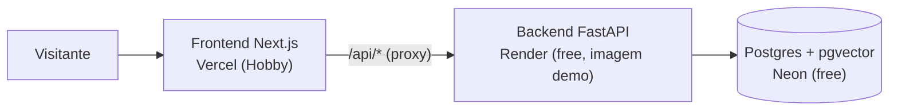

# Deploy da demonstração pública

A demo pública mostra três editais já analisados pela IA, para quem avalia o projeto ver os
resultados sem esperar e sem gastar tokens. Ela roda com `DEMO_MODE=true`: envio de PDF,
importação do PNCP, nova análise e busca na lei ficam desativados; perfis e verificação de
aptidão funcionam, sem a IA. O porquê de cada escolha está nas ADRs 039 a 042 de
[DECISOES.md](DECISOES.md).



## Comparação das opções

Valores das páginas oficiais, consultadas em 12/11/2026. Preços mudam: confira antes de
criar as contas.

| | Render | Railway | Fly.io |
| --- | --- | --- | --- |
| Backend grátis | sim: 512 MB, 0,1 CPU, dorme após 15 min sem tráfego (acorda em ~1 min) | US$ 1 de crédito/mês, 0,5 GB por serviço | não há plano grátis para contas novas |
| Menor plano pago | US$ 7/mês (512 MB, não dorme) | Hobby US$ 5/mês, com US$ 5 de uso incluído | máquina de 512 MB por US$ 3,69/mês |
| Postgres | grátis por 30 dias, depois expira; pgvector disponível | cobrado pelo uso (RAM e disco) | gerenciado a partir de US$ 38/mês |
| Configuração no repositório | `render.yaml` (Blueprint) | `railway.json` | `fly.toml` |

Fontes: [Render free](https://render.com/docs/free), [Render compute plans](https://render.com/docs/compute-plans),
[Railway plans](https://docs.railway.com/reference/pricing/plans), [Fly.io pricing](https://docs.fly.io/about/pricing),
[Neon plans](https://neon.com/docs/introduction/plans), [Vercel Hobby](https://vercel.com/docs/plans/hobby).

**Recomendação: Render (backend) + Neon (Postgres) + Vercel (frontend), tudo no plano
gratuito.** O Render roda a imagem Docker de graça e lê a configuração do `render.yaml`. O
Postgres gratuito do Render expira em 30 dias, o que quebraria o link do portfólio; o do
Neon (1 GB, pgvector, dorme após 5 min) não tem expiração na página de planos. O custo é a
primeira visita depois de um tempo parada: o Render leva cerca de 1 minuto para acordar.
Se isso incomodar, o plano Starter do Render (US$ 7/mês) não dorme e não exige mudança no
código.

A imagem `demo` do backend não leva PyTorch, o modelo de embeddings nem o Tesseract, e por
isso cabe nos 512 MB. Ela só serve as análises semeadas.

## Passo a passo

São três contas (Neon, Render e Vercel), todas com login pelo GitHub. Nenhum segredo vai
para o repositório: os valores ficam nos painéis.

### 0. Gerar os snapshots da demo (uma vez, custa dinheiro)

A demo mostra análises reais. Elas são geradas localmente, com a chave da Anthropic no
`.env`, e commitadas em `data/demo/`:

```bash
just demo-generate
```

O comando analisa Lauro Müller, Palhoça e Witmarsum, verifica o perfil de exemplo contra
cada um e grava um JSON por edital. Cada análise fica limitada a `ANALYSIS_MAX_COST_USD`
(US$ 3,00 por padrão). Confira os resultados na interface local antes de commitar.

### 1. Banco no Neon

1. Crie um projeto no [Neon](https://neon.com) na região AWS US East (N. Virginia), perto do
   Render em `virginia`.
2. Copie a connection string (`postgresql://...?sslmode=require`). A migração `0001` ativa
   o pgvector sozinha (`CREATE EXTENSION IF NOT EXISTS vector`).

### 2. Backend no Render

1. No [Render](https://render.com), escolha **New > Blueprint** e aponte este repositório.
   O Render lê o `render.yaml` e cria o serviço `edital-claro-api`.
2. Quando pedir `DATABASE_URL`, cole a connection string do Neon. O formato `postgresql://`
   é convertido para o driver do projeto automaticamente.
3. O primeiro deploy constrói a imagem `demo`, aplica as migrações e carrega os snapshots.
   Confira em `https://<serviço>.onrender.com/health`: `"database": "ok"` e `"demo": true`.
4. Em **Environment**, copie o valor gerado de `PROXY_TOKEN` (vai para o Vercel).

O deploy automático só acontece depois que o CI do commit passa (`autoDeployTrigger:
checksPass`).

### 3. Frontend no Vercel

1. No [Vercel](https://vercel.com), importe o repositório e defina **Root Directory** como
   `frontend`. O framework (Next.js) é detectado sozinho.
2. Variáveis de ambiente:

   | Variável | Valor |
   | --- | --- |
   | `API_URL` | `https://<serviço>.onrender.com` |
   | `PROXY_TOKEN` | o mesmo valor do Render |
   | `CLIENT_IP_HEADER` | `x-real-ip` |

3. Faça o deploy e abra a URL do Vercel. O aviso "Demonstração" aparece no topo e a página
   inicial lista os três editais.

`PROXY_TOKEN` e `CLIENT_IP_HEADER` fazem o rate limit contar cada visitante, e não o
servidor do Vercel (ADR-040). Sem eles a demo funciona, mas todos os visitantes dividem o
mesmo limite.

## Operação

| Tarefa | Como |
| --- | --- |
| Restaurar a demo (apaga perfis e verificações criados por visitantes) | `DATABASE_URL=<Neon> just demo-reset` na sua máquina |
| Atualizar as análises depois de mudar o pipeline | `just demo-generate`, commit e push |
| Exportar uma análise específica do banco local | `just demo-export <id da análise> <nome>` |
| Ver a demo localmente | `docker compose -f docker-compose.yml -f docker-compose.demo.yml up --build` |

O seed roda em todo start e só carrega o que falta, então um deploy novo não duplica nada.
O reset não apaga o índice da lei.

## Limitações da demo

- O Render dorme após 15 minutos sem tráfego; a próxima visita espera cerca de 1 minuto.
- O Neon dorme após 5 minutos; a primeira consulta depois disso demora um pouco mais
  (`DATABASE_CONNECT_TIMEOUT_SECONDS=15` no `render.yaml`).
- O plano gratuito do Render não tem disco persistente; a demo não precisa, porque os PDFs
  vêm dentro da imagem.
- Não há login: perfis criados por visitantes ficam visíveis para todos até o próximo reset.
  Por isso a demo não deve receber dados reais de empresas.
